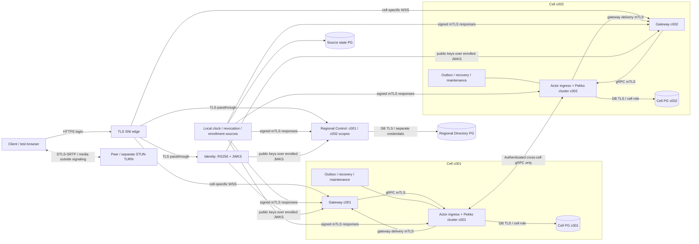

# WebRTC Signaling Platform trên Minikube — production-like local deployment

Date: 2026-10-13
Status: APPROVED_FOR_PLANNING — user approved 2026-10-13; implementation and deployment NOT_RUN.
Environment: **LOCAL_TEST_ONLY** / `local-minikube` / `local-test-only`.
Qualification: **NOT_QUALIFIED**. Minikube acceptance can become `LOCAL_QUALIFIED` only; production, HA, physical fencing and 10M capacity remain `NOT_QUALIFIED`.
Source baseline: `main`, `dd94cd49c54b89dbc67976e739fb0df450f689cf`; existing unrelated working-tree edits are outside this design.

## 1. Mục tiêu, phạm vi và thứ tự ưu tiên contract

Triển khai toàn bộ signaling platform vào một Minikube cluster để development, integration test và local qualification chạy qua networking, TLS, Kubernetes lifecycle và PostgreSQL thật. Giữ nguyên logical ownership và security/consistency contract của production; giảm tài nguyên và physical placement bằng profile local có kiểm soát.

Luồng bắt buộc: `Login → JWT RS256 → Bootstrap → Directory Resolve → WSS Connect → Gateway → Actor RPC → Pekko Actor → PostgreSQL → Cross-cell signaling`. Có hai home cell `c001`, `c002`, hai actor cluster độc lập, hai Cell PostgreSQL độc lập, Regional Directory PostgreSQL riêng và Identity Service riêng. SDP/ICE là signaling metadata; audio/video/datachannel media đi P2P hoặc qua STUN/TURN riêng.

Spec này là deployment/composition overlay của [production v1.11](2026-10-03-webrtc-signaling-10m-design-v1.11-production.md), [runtime resource/provider contract](../../contracts/runtime-resource-retention-provider-contract.md), [WAL enrollment contract](../../contracts/native-production-wal-enrollment.md) và [claim lifetime contract](../../contracts/identity-claim-lifetime-policy.md). Các contract đó quyết định business semantics; không sửa để làm Minikube dễ chạy. Riêng cách phát hành và phân phối key của [Identity dev spec cũ](2026-10-13-signaling-identity-design.md) được thay bằng yêu cầu mới trong tài liệu này: Secret-mounted signing key, HTTPS và JWKS refresh/rotation, không dùng key đóng gói trong JAR.

Không thuộc acceptance local: multi-AZ availability, node/region disaster recovery, hardware fence, 10M connections, N−1 capacity, production provider attestation, production identity integration hoặc 24h production soak. PVC trên cùng một node và nhiều pod trên cùng host không tạo các failure domain độc lập.

## 2. Các lựa chọn và quyết định

| Phương án | Lợi ích | Trade-off / kết luận |
| --- | --- | --- |
| **Chọn: mở rộng chart hiện tại bằng composition local riêng** | Tái sử dụng application image, native runtime, TLS/RPC/SQL và validation production; thêm regional/identity/platform releases | Phải bổ sung enrollment adapter và source services thực; giữ actor quorum hiện hành nên cần máy development đủ lớn |
| Chart Kubernetes local viết hoàn toàn riêng | Dễ bắt đầu và chỉnh từng workload | Dễ drift giữa runtime, network, shutdown, chart production; không chọn làm implementation chính |
| Một Spring process, một actor cluster hoặc một database dùng chung cho cả hai cell | Ít resource | Không đáp ứng boundary và không chứng minh cross-cell RPC; loại khỏi deployment này |

Không dùng service mesh để thay thế application mTLS hoặc operation authorization. Không thêm Redis vào authority path; cache tùy chọn không cần cho acceptance tối thiểu. Không embed Identity vào gateway/control. Các phần việc có thể chia thành Identity/JWKS, platform authority/enrollment, Kubernetes composition và qualification harness, nhưng phải hội tụ vào cùng một deployed candidate và cùng một spec.

## 3. Những gì đã có và những gì phải bổ sung

Đây là source assessment, không phải danh sách tính năng đã được deploy.

| Source hiện tại | Khả năng / gap quan sát được | Yêu cầu của triển khai |
| --- | --- | --- |
| `signaling-identity/IdentityConfiguration`, `RsaKeyMaterial`, `application.yml` | Login và single-key JWKS đã có; key cố định `classpath:keys/*`, default issuer HTTP và account sample | Secret-mounted key ring/account config, TLS, rotation/retirement, image không chứa private key hoặc sample password |
| `signaling-auth/TrustedRsaKeys`, `Rs256TokenVerifier` | Strict RS256/claims và refresh callback; refresh chủ yếu khi gặp unknown kid; không có network JWKS fetcher/freshness lifecycle | Enrolled HTTPS JWKS owner, periodic refresh, bounded cache, retirement state, readiness/admission guard |
| `MountedNativeContract`, `MountedProductionContract`, `RuntimeSecretEnvironment` | Parse/validate mount và configuration; production contract loại local input | Adapter tạo đầy đủ native enrollment beans và runtime owners; parse thành công không chứng minh composition đã cài |
| `NativeRuntimeStartup` | Từ chối launch chỉ có Spring configuration; yêu cầu worker, RPC và runtime thật | Giữ gate này; phải kiểm tra actor roots/regions và concrete workers trong deployed JVM |
| `BootstrapController`, `DirectoryService`, `PostgresDirectoryRepository` | Bootstrap trả `wssUrl`; directory routing cache là hint; repository gồm regional và một local-cell authority | Regional control có hai instance scope theo cell, không đổi thành shared cell authority; xem §4 |
| `NativeControlReadiness` / `NativeControlProcess` | Readiness cần compatibility, clock/security và bucket-transfer owner đã cài | Enroll transfer owner thật, không gán `transferInstalled=true` giả hoặc bỏ gate |
| `ShardingBootstrap`, `ClusterReadiness` | Formation 6 contact points; ít nhất 4 Up actors; local readiness chỉ giảm failure-domain count từ 2 xuống 1 | Giữ 6 actor/cell và quorum 4, dùng đúng local exception; không tạo AZ giả |
| Helm `signaling` | Có `local-minikube`, một gateway/control; vẫn cố định actor 6+1, PDB4; chart ghép ba plane một release | Tách enabled planes và regional control khỏi cell release; thêm local composition, identity, Secret refs, probes/TLS và exact peer policies |
| CNPG manifests / `NativeWalSource` | Production three-AZ DB, synchronous ACK và pinned replica identity | Overlay local có standby thực, measured WAL facts và admission gate; không dùng `localSingleWriter` cho candidate này |
| CNPG1.27 management/metrics | Status8000 dùng TLS nhưng không client authentication; operator metrics8080 plaintext, DB metrics9187 TLS tùy chọn | Giữ exact operator-only network boundary cho status; bật DB metrics TLS và co-located mTLS export cho operator metrics, không scrape8080 qua pod network |
| `NativeActorMaintenance`, `NativeWorkerScheduler` | Recovery, durable outbox, retention/privacy đã có concrete composition | Workers chạy trong actor pods theo ownership hiện hành; không mở worker cluster khác |
| `PrivateHealthServer`, chart probe/monitoring | Health/metrics hiện là HTTP trên PodIP | Thêm private TLS/mTLS listener và authenticated exec probes; không chỉ đổi `scheme: HTTPS` trong YAML |
| `NativeTelemetry`, `TraceContext` | Có bounded metrics/logs và trace correlation; correlation chưa chứng minh exported distributed spans | Bổ sung bounded trace exporter/propagation và collector; receipt IDs giữ nguyên semantics |

Các gap trên là prerequisite bắt buộc. Không dùng fixture Testcontainers, in-memory repository, `alwaysAllowed`, constant freshness hoặc dummy provider bean để lấp gap.

## 4. Topology và ownership

### 4.1 Namespace và workload

Namespace prefix đề xuất: `wsa-*`; tất cả có label/annotation `signaling.qualification=LOCAL_TEST_ONLY` và run/environment ID.

| Namespace | Workloads và replica mặc định | Authority và quyền truy cập |
| --- | --- | --- |
| `wsa-edge` | 1 edge TCP/TLS SNI router | Public HTTPS/WSS; chuyển tiếp TLS tới đúng service, không authorize JWT hoặc chọn home cell |
| `wsa-identity` | 1 `signaling-identity` | Login, JWT signing, public/internal JWKS; chỉ workload này mount JWT private keys |
| `wsa-regional` | `control-c001`: 1, `control-c002`: 1; Directory PostgreSQL: primary + standby | Một logical Regional Control Plane, shared regional directory; mỗi control instance có đúng một cell scope cho local bucket authority |
| `wsa-c001` | Gateway: 1; actors: 6; Cell PostgreSQL: primary + standby | Cell `c001`; workers chạy trong actor processes, cell-local actor discovery/DB |
| `wsa-c002` | Gateway: 1; actors: 6; Cell PostgreSQL: primary + standby | Cell `c002`; không join discovery, remoting hoặc SQL authority của `c001` |
| `wsa-platform` | Local authority/source service: 1; source PostgreSQL: primary + standby; node clock observer: 1/node; bounded enrollment Jobs | Clock/revocation/key-retirement source, enrollment, local fence evidence; source DB chỉ chứa source-control state |
| `wsa-observability` | Prometheus, OTEL Collector, trace/log backend, dashboard: mỗi loại 1 | Thu metrics/logs/traces bằng TLS/mTLS; không có business authority |
| `cnpg-system` | Operator theo pin repository | Chỉ quản lý DB, không phải bằng chứng writer fencing |

Source PostgreSQL bổ sung giữ durable revocation log, monotonic source sequence/high-water và retirement tombstones. Không dùng Regional Directory tables hoặc cell tables cho state của Identity/source. Một physical source DB với schema/role tách biệt cho source events là chấp nhận được; ba signaling authority DB tuyệt đối không gộp vào đó.

Hai control instance nằm trong regional namespace để giữ public regional API và source composition hiện hành, vốn gắn một `NativeControlDatabaseEnrollment` với một local cell. Cả hai đọc toàn bộ regional mapping; `control-c001` chỉ được truy cập bucket authority của DB `c001`, `control-c002` chỉ DB `c002`. Migration coordinator chỉ gọi các cell-scoped transfer owners đã enroll. Không dùng một cell làm quyền mặc định cho cả region, cũng không cấp cả hai Cell DB credentials cho mọi control pod.

### 4.2 Sơ đồ

Gateway và control không join actor cluster. Actor system names, namespace, discovery selector, cell-local remoting trust và immutable fingerprints phải khác nhau giữa hai cell. Canonical member address dùng PodIP cùng UniqueAddress UID; Service VIP chỉ dùng làm RPC endpoint, không làm Artery member address. Một actor PodIP mới không được tái sử dụng boot/member incarnation cũ.

### 4.3 Service và public naming

Các hostname local cố định trong environment config: `identity.wsa.test`, `bootstrap.wsa.test`, `c001.wsa.test`, `c002.wsa.test`. Dùng `/etc/hosts` hoặc DNS local trỏ đến edge IP từ Minikube tunnel/driver; preflight chứng minh browser và test runner resolve được. Không trả cluster-internal DNS hoặc PodIP trong public `wssUrl`.

| Service | Port / transport | Exposure |
| --- | --- | --- |
| Identity public | 8443 HTTPS: `/api/v1/auth/login`, `/.well-known/jwks.json` | Public qua edge; browser không cần client certificate |
| Identity internal JWKS | 9443 HTTPS/mTLS, cùng key ring | Chỉ enrolled JWT-verifying workloads |
| Regional bootstrap | 8443 HTTPS: `/v1/signaling/bootstrap` | Public regional host; backend hai control scopes, không route theo unverified userId |
| Cell gateway client | 8443 WSS | Public hostname riêng từng cell; TLS kết thúc tại Netty gateway |
| Cell actor ingress | 8443 gRPC/mTLS, HTTP/2 ALPN | ClusterIP/private; same-cell gateway và authorized peer actors |
| Gateway relay receiver | 9443 gRPC/mTLS | Private; exact gateway workload/boot identity |
| Actor discovery `signaling-c001` / `signaling-c002` | Headless; 8558 management mTLS, 25520 Artery TLS1.3/mTLS | Chỉ same-cell actor pods; discovery có thể publish not-ready addresses |
| Health/metrics | 8559 private TLS/mTLS | Pod-private; no public Service route; exec probes và authorized Prometheus |
| PostgreSQL writer/replication | 5432 TLS; JDBC `sslmode=verify-full`, client auth | Writer endpoints và replication private; không NodePort/public ingress |
| CNPG status/DB metrics | 8000 server TLS / 9187 server TLS với CA verification | Status operator-only; scrape metrics authorized namespace; không giả rằng pinned CNPG hỗ trợ mTLS trên các listener này |
| Local sources | 8443 HTTPS/mTLS | Endpoint URL, response signature keys và caller scope được enroll |
| OTLP/export | 4317 gRPC/mTLS hoặc 4318 HTTPS/mTLS được chọn nhất quán | Observability namespace; không plaintext fallback |

Edge chọn upstream bằng exact SNI; không sửa Origin, không redirect WSS giữa cell, không biến `c001` thành round-robin chung với `c002`. Nếu TLS termination được thêm sau này, hop edge→application bắt buộc re-encrypt và authenticate mTLS; profile chuẩn chọn passthrough để giữ endpoint authentication tại application.

## 5. Invariant không được thay đổi

| Contract | Ràng buộc local |
| --- | --- |
| Routing authority | 16,384 directory buckets, hash version hiện hành; không `hash(userId) mod liveCellCount`; 1,024 actor ownership groups/shards không đồng nghĩa directory buckets |
| Session identity | `(iss,jti)` bind userId; socket mới có `connectionId` mới và SQL-allocated generation tăng; gateway process boot ID mới sau restart |
| Call ownership | Coordinator cell/routing epoch của call bất biến; CallActor group lease và SQL barriers quyết định authority, không actor placement hoặc Service endpoint |
| Fencing | Cell/storage/bucket/group epoch, owner incarnation, lease sequence và expiry được kiểm tra như production trong transaction; không bypass bởi LOCAL_TEST_ONLY |
| Lease và time | TTL, renewal, SBR, deadlines giữ contract hiện hành; clock invalid/uncertain đóng mutation gate; không kéo dài TTL để mask CPU starvation |
| Idempotency | Retry giữ requestId, commandScope, payload hash; khác payload cùng identity bị reject; timeout/UNKNOWN không tạo operation mới |
| Durable outbox | Commit business state và outbox cùng transaction; retry/reconcile theo exact event ID; socket write không phải application ACK |
| Application receipt | Chỉ exact `EVENT_RECEIVED` hoàn tất `APPLICATION_RECEIVED`; loss/restart phải giữ pending state |
| Cross-cell | Workload mTLS + operation proof, destination/storage/routing scope; saga/reservation/activation compensation giữ production semantics; không shared actor cluster/cross-cell SQL |
| Authorization | RS256 verification không cấp quyền call tự động; CallAuthorizationPolicy phải được enroll, deny/unknown fail closed |
| Recovery | Hydrate từ primary và durable state; không replay tùy ý SDP/ICE volatile; `RESYNC_REQUIRED` theo contract; healthy media không bị reset chỉ do WSS đổi route |
| Resource ownership | Logical deadline không giải phóng physical SQL/RPC work sớm; admission và drain chờ original physical receipts; không tăng queue không giới hạn |

Chỉ physical placement/replica capacity được điều chỉnh như §11. Không giảm actor quorum hoặc synchronous ACK threshold. Nếu host không chạy được envelope tối thiểu thì preflight báo insufficient resources; không tự hạ semantics.

## 6. Identity, JWKS, refresh và retirement

### 6.1 Identity Service

Identity image dùng reactor Java21/Spring Boot và executable artifact riêng. Image layer, JAR resources, build context và generated manifest không chứa JWT private key hoặc account password. Key mặc định đã commit trước đây là public test artifact, phải loại khỏi deployable packaging và không dùng cho profile mới; spec này không rewrite Git history.

Signing key ring và account configuration load từ Kubernetes Secrets read-only. Private signing key chỉ được mount vào Identity container; Kubernetes Secret là nơi lưu, PKI/key generation Job chỉ giữ temporary generation material trong memory trước khi import. Không mount JWT private key vào gateway, actor, control, source service, sidecar, image builder hoặc observability.

Login giữ endpoint/response hiện hành: JSON username/password; generic invalid-credentials errors; `Cache-Control: no-store`. JWT có `alg=RS256`, explicit bounded `kid`, `typ=JWT`, `iss`, `aud`, `userId`, fresh `jti`, integral `iat`, `exp`, nonnegative `securityEpoch`. Default local TTL 15 phút, `maximumJwtLifetime=15m`, clockSkew 30s và `REQUIRE_IAT`. `iss=https://identity.wsa.test` là identity constant; internal JWKS URL khác không được thay issuer.

Mỗi login cấp session mới. Không giả rằng login lại là AUTH refresh của cùng session: reconnect dùng JWT/session cũ còn hợp lệ; khi hết hạn, explicit new login/session replacement phải theo existing protocol. Không thêm refresh-token API vào scope này; `preserveJtiOnRefresh=true` trong security contract giữ nguyên cho bất kỳ refresh path nào được sử dụng.

Accounts local và calling policy được đánh dấu LOCAL_TEST_ONLY. Chọn policy `open authenticated test users`, giới hạn vào enrolled test principal set; authenticated user ngoài set hoặc unavailable policy source bị deny. Không áp dụng default `allow all` cho production.

### 6.2 JWKS owner và cache

Mỗi process cần verify JWT phải có đúng một JWKS cache owner, tích hợp `TrustedRsaKeys`/`BoundedTokenVerifier`. Control và gateway bắt buộc; actor chỉ mount public trust nếu có JWT-verifying path, không thêm JWT HTTP fetch vào mỗi RPC nếu RPC đã dùng authenticated proof.

Endpoint internal được pin bằng enrollment: HTTPS URL canonical, issuer, audience, CA/expected service identity, timeout và body/key bounds. Token không được chọn URL; reject `jku`, `x5u`, unsupported alg/critical headers. Parser kiểm tra unique kid, RSA≥2048, `kty=RSA`, `use=sig`, `alg=RS256`, canonical n/e; reject private JWK fields, duplicate fields, oversized/ambiguous documents và cùng kid nhưng khác key material.

Default local cache policy: refresh period 30s, hard freshness 60s từ last successful authenticated snapshot; one in-flight refresh/process, original deadline ≤2s, body≤64KiB, ≤64 keys, unknown-kid refresh coalesced/rate-limited tối đa một attempt/5s/process. Bounded executor/cache; refresh không chạy trên Netty event loop hoặc actor dispatcher. HTTP cache headers không được kéo dài hard freshness; validated 304 chỉ gia hạn khi vẫn authenticate đúng endpoint và cùng enrolled snapshot version.

Khởi động cold cache: không ready và không accept token trước initial validated fetch. Unknown kid: trigger refresh nhưng request hiện tại bị reject với typed retry advice theo protocol; không accept trước khi key được xác thực. Known kid: tiếp tục verify khi snapshot còn fresh và retirement/revocation/clock gates valid. Network outage, TLS mismatch hoặc malformed refresh không cập nhật freshness; hard expiry đóng AUTH/refresh/new protected admission. Snapshot khác nhưng valid thay cache atomically. Invalid trust/key identity hoặc explicit retirement đóng affected scope ngay, không chờ freshness timeout.

Public PEM bootstrap bundles không được là nguồn fallback vô hạn. Key từ JWKS mới là distribution path của deployment; trust anchors/source-signature keys là enrollment riêng. Signing-key retirement giữ deny state monotonic, durable tại source authority và được replay sau consumer restart trước ready; stale JWKS không được resurrect retired kid.

### 6.3 Rotation/retirement

Admin operations dùng private mTLS endpoint/authorized Kubernetes Job, idempotent operation ID và expected source/key-ring version. Không public rotation API, không ghi Secret contents vào job logs.

1. Generate K2, store Identity-only Secret; publish public K1+K2 qua JWKS. Identity vẫn sign K1.
2. Thu validated snapshot/version observation từ mọi active verifier workload; pending verifier không được ready. Chưa propagate thì chưa switch signing.
3. Atomic switch active signer sang K2; Identity replicas không được serve mixed key-ring version sau rollout. K1 vẫn verify cho token hợp lệ chưa hết hạn.
4. Planned retirement: dừng sign K1, đợi last K1 issuance + maximumJwtLifetime + clockSkew và observed cache propagation; append durable retirement record rồi gỡ K1 khỏi JWKS.
5. Emergency retirement: append monotonic durable retirement record ngay, publish deny state và đóng affected sessions/critical operations trong enrolled propagation bound; không đợi JWT TTL. Restart consumer phải apply retirement high-water trước admission.

K1/K2 không reuse kid. Freshness bound không thay revocation SLO. Key deletion không xóa retirement tombstone cần chống replay. Rotation acceptance cần old/new valid tokens, unknown kid refresh, stale response, outage, retirement và restart tests (§14).

## 7. PKI, Secrets và runtime enrollment

### 7.1 Trust domains và certificates

PKI generate mới cho mỗi environment/run, certificate subject/metadata ghi LOCAL_TEST_ONLY. Tách public server CA, internal workload CA, cell-local remoting CA `c001`/`c002`, DB server/client CA và source-signature key material. TLS keys, RSA JWT keys và Ed25519 proof/source keys là các key khác nhau.

Internal signaling application transport dùng TLS1.3/mTLS; PostgreSQL dùng TLS với verify-full và authenticated client certificate + scoped DB role/SCRAM nếu contract driver yêu cầu. CNPG infrastructure listeners dùng server-authenticated TLS cùng exact network/role boundary theo pinned implementation; đây không phải application RPC mTLS. Không accept plaintext DB connection. Public browser HTTPS/WSS dùng server TLS và JWT, không yêu cầu browser workload mTLS.

RPC SAN phải khớp parser hiện hành: `spiffe://signaling/local-test-only/cell/c001/actor/<workloadId>` hoặc `/gateway/<gatewayId>`, tương tự `c002`; đúng một matching workload URI. DNS SAN khớp enrolled `tlsAuthority`/Service FQDN. Control/Identity/source/telemetry dùng trust identity riêng trên HTTP/telemetry endpoints, không ép thành actor role để vượt parser.

Artery/management chỉ tin certificate của actor cùng cell. RPC có thể tin selected peer cell CAs nhưng luôn kiểm tra URI environment/cell/role và operation proof; chỉ CA trust không đủ. Cross-cell gateway-to-Artery, gateway-to-peer actor quyền vượt scope, cert từ production hoặc environment local khác phải fail.

CA private keys nằm ở PKI issuer Secret, chỉ provisioning identity được quyền sử dụng; workload leaf keys nằm ở riêng Secret của workload/incarnation. Certificate signer cấp DNS+URI SAN từ trusted namespace/SA/Pod identity, không ký SAN arbitrary từ caller. Không share một private workload key cho tất cả actor pods. Cần per-pod Secret provisioning/controller và projected volume before startup; chưa có Secret thì pod pending/unready, không fallback shared credential. Rolling renewal bảo toàn boot/session/lease identity, chỉ đổi certificate theo allowed trust overlap.

### 7.2 Secret inventory và access

| Secret family | Mount / consumer duy nhất hoặc được scope |
| --- | --- |
| `identity-signing-<version>` | Identity container: active/verify-only key ring, private PEM; các process khác không mount |
| `identity-accounts-<version>` | Identity: local accounts/credential material, không ConfigMap/sample default |
| `pki-issuer-*` | Provisioning issuer Job/controller; không application pods |
| `workload-tls-<podUID>` | Exact process: leaf/key, public CA bundles; remoting.p12/trust.p12 và password keys khi là actor |
| `db-client-<scope>-<role>` | Exact actor/control/source or migration role; certificate, key, username/password |
| `db-server-*`, `db-replication-*` | CNPG-managed DB instance và replication identity |
| `runtime-<plane>-<scope>-<version>` | Exact plane: runtime.yaml, typed enrollment references, source trust keys, approved peer targets, directory snapshot metadata |
| `proof-signing-<cell>-<version>` | Authorized cell proof issuer only; consumer chỉ nhận public verification keys |
| `source-signing-*` | Clock/revocation source signer; independent JWT keys |
| `privacy-key-<cell>` | Required privacy worker in own cell |
| `telemetry-client-*`, `admin-job-*` | Collector/scraper or short-lived authorized provisioning Job |

Mount keys read-only mode 0440 hoặc tighter phù hợp UID/fsGroup, root filesystem read-only, memory-backed temporary work. Secret references có thể commit; Secret manifests với `data`/`stringData`, generated PKI, credentials, enrolled runtime documents và private material không commit, kể cả base64. Generated artifacts ở ignored `.superpowers/...` hoặc memory temporary directory; default output chỉ public fingerprints/references. Không in `kubectl get secret -o yaml`, authorization headers hoặc token values vào evidence.

Kubernetes Secret không tự chứng minh encryption at rest. Provision profile phải bật/kiểm chứng Secret encryption at rest ở API server và giới hạn RBAC; encryption configuration/key không đưa vào Git. Profile thiếu xác nhận này không đạt security acceptance. [Kubernetes Secrets](https://kubernetes.io/docs/concepts/configuration/secret/) mô tả lưu trữ và yêu cầu bảo vệ này.

### 7.3 Enrollment và boot

Adapter local riêng, chỉ activate khi `SIGNALING_DEPLOYMENT_MODE=local-minikube` cùng `SIGNALING_LOCAL_ACKNOWLEDGEMENT=LOCAL_TEST_ONLY` và explicit local environment contract. Production parser/startup tiếp tục reject mọi local profile/source. Không fabricate `MountedProductionContract` với tên AZ/provider giả.

Static non-secret config có thể nằm ConfigMap; runtime enrollment và credential references có thẩm quyền nằm Secret. Secret runtime.yaml phải dùng grammar hiện hành của `RuntimeSecretEnvironment`; enrollment JSON dùng schema versioned riêng, không giả hai format là một. Giữ mount root `/run/signaling`, canonical path validation, size/duplicate/type validation. Document/schema mới phải versioned và test compatibility nếu thay static `jwtPublicKeys` bằng JWKS enrollment.

Adapter phải tạo đúng một owner/bean của mỗi runtime family cần cho plane: DB pools/admission/SqlTransactions, trust/BoundedTokenVerifier, directory sources, clock/security, WAL/authority, compatibility, policy, RPC clients/server, native actor factories/lease bridge, maintenance/recovery/retention/privacy, scheduler, startup cleanup/shutdown và telemetry. Bean phải cùng identity/ownership graph; không dùng supplier constant để đáp ứng constructor.

Enrollment bind environment ID, cell/scope, storage epoch, routing/hash/schema version, configuration fingerprint, image/source digest, permitted peer set, source keys/endpoints, DB system identifier/timeline/synchronous replica IDs, calling policy version và approved formation intent. Downward API Pod UID/name/IP/namespace là runtime inputs; processBoot là random mới mỗi JVM, không stored stable in Secret. Enrollment issuer authenticate projected ServiceAccount + validate live Pod identity; startup PID/JVM nhận per-boot source authorization, không trust client-supplied Pod UID headers alone.

Initial actor formation chỉ qua bounded `initial-six` authorization sau DB/schema/authority provisioning; bình thường `join-only`. Full-cell restart phải đi `authorized-reformation` với fresh local recovery evidence; một Helm value không tự cấp quyền hình thành cluster mới. Không renew bootstrap authorization vô hạn và không auto-create storage epochs từ application startup.

## 8. Clock, revocation và database authority sources

### 8.1 Local source service

Source service là implementation local của existing contracts, có riêng Maven artifact/image/chart; không phải external production authority. Cung cấp signed HTTPS/mTLS clock reports, revocation batches/scoped snapshots, enrollment và local fault/admin controls. Mỗi endpoint kiểm tra expected caller workload, scope và boot authorization; response dùng strict content-length JSON framing/limits tương thích `NativeSourceHttp`, không chunking/redirect/compression fallback.

Artifact đề xuất là `signaling-local-platform`, chỉ được cài trong LOCAL_TEST_ONLY composition; production runtime không include auto-configuration của module này. Durable source SQL/schema/roles và typed event/report API được versioned trong module; fault endpoint không được quyết định business state ngoài các source/admin contracts đã authorize.

Clock report bind keyId, cell, storageEpoch, podUID, processBoot, strictly increasing sequence, observedAt/validUntil, uncertainty, relative rate error và continuity như `ClockSafetyMonitor.Report`. Node observer kiểm tra host time synchronization/continuity và measured uncertainty; source không phát report `continuous=true`, zero uncertainty hoặc fixed timestamp vô điều kiện. Dùng monotonic sampling và host boot/time-step detection. Report window≤5s; uncertainty≤250,000µs và relative rate error≤1,000ppm chỉ khi đo được; poll cadence giữ native safety schedule 100ms. Measurement unavailable hoặc stale ⇒ invalid report/no admission.

Tất cả pod cùng node có correlated clock failure; chữ ký xác thực nguồn, không chứng minh clock quality hoặc independent production clock source. Host observer có minimal read-only host access trong riêng privileged namespace nếu platform cần; application namespaces vẫn restricted. Fault harness inject source invalidity/offset tại source contract, không chỉnh global host clock gây ảnh hưởng máy người dùng.

Revocation source lưu append-only ordered log trong Source PostgreSQL, event scope issuer/user/session/kid/securityEpoch, durable cursor/high-water và signer identity. Identity đọc epoch và ghi local logout/disable/key-retirement admin event qua authenticated source API; source outage đóng token issuance khi không xác định current security state. Event transport có idempotent operation ID; state commit trước publish, restart không rewind epoch hoặc high-water.

Actor cells apply event và persist local authoritative security state/cursor trước acknowledge. Gateway scoped cache phản ánh committed cell security state qua authenticated cell source; không coi source high-water chưa apply tại cell là permission mới. Control có source-scoped durable checkpoint/bootstrap snapshot từ Source DB; cold cache không ready trước caught-up. Signed batch `caughtUp` chỉ true sau cursor/high-water check; empty log cũng cần fresh signed report. Default local revocationPropagationSLO=2s, hardSafetyBound=5s, phù hợp native freshness cap; unavailable poll không gia hạn usable state.

Immediate retirement/revocation đóng affected sockets và critical operations; out-of-order epoch, duplicate batch và replay không hồi phục quyền. Test revocation scope cả hai cell và restart consumers. Local admin/fault endpoint không expose qua edge, không bật trong production.

### 8.2 Database durability, writer identity và restart

Dùng pinned CNPG/PostgreSQL từ `config/compatibility-manifest.yaml` cho Directory, mỗi Cell DB và Source DB. Mỗi cluster local có hai instance: một writer, một synchronous standby; distinct PVC. `synchronous_commit=on`, `synchronous.number=1`, `dataDurability=required`. Nếu standby mất, critical commit block/timeout và admission đóng; không tự dùng asynchronous fallback hoặc `remote_write`. [CNPG 1.27 replication](https://cloudnative-pg.io/docs/1.27/replication/) quy định behavior này.

Single-node overlay bỏ required physical zone anti-affinity/cross-AZ election constraint để scheduling được, nhưng giữ one-standby durable ACK threshold và ghi `physicalFailureDomains=1`. Không gán nhãn fake AZ để qua production admission; đây là local placement exception, không bằng chứng production cross-AZ durability. `localSingleWriter=false`; single-DB/no-standby profile không đạt spec này.

App JDBC kết nối writer endpoint được admission xác thực, không read replica. PostgreSQL server enforce TLS-only `pg_hba`, client certificate mapping/scoped SCRAM và least-privilege roles; replication cũng TLS authenticated. Local DB role không được DDL/epoch-init quyền của migration role. Regional controls có directory role cùng own-cell bucket role; gateways không có DB password/SQL access.

WAL/primary probes dùng actual SQL, systemIdentifier, timeline, storageEpoch, configured synchronous policy và exact enrolled standby identity/health. DNS `-rw`, CNPG Ready, `pg_is_in_recovery=false` hoặc Secret đúng format không đủ mở authority. Verified SQL barriers vẫn chạy trên mỗi mutation. Admission snapshot có bounded age theo native poll/contract.

Regional writer/source writer adapters dùng authority schema của chính database đó, cùng PostgreSQL system/timeline/WAL observations; không chạy `PrimaryCellFacts` yêu cầu `cell_authority` trên Directory/Source DB, không tạo cell actors/ownership tables để làm query pass. Chỉ Cell DB sử dụng existing cell/group/bucket authority barriers. Exact replica application_name list phải được provision và observe trước issuing WAL enrollment; primary/standby role swap không được silently đổi set trong process.

Initial authority provisioning chỉ chạy khi cluster mới, migration digest đúng và explicit admin intent; schema role/migration Jobs riêng, idempotent và checksum-validated. Seed 16,384 regional buckets deterministic, một phần `c001`, phần còn lại `c002`; local bucket authority tương ứng phải ACTIVE đúng epoch trước publish. Test users được chọn bằng actual `BucketHasher` để bảo đảm khác cell, không hardcode rằng alice/bob luôn khác cell. Boot application không chạy destructive recovery hoặc viết epoch tự động.

Database restart acceptance chính là restart cùng admitted writer trên cùng PVC, mọi mutation gate đóng trong khoảng không có usable writer/WAL/clock/security facts. Admission chỉ reopen sau identity/timeline/epoch và synchronous catch-up được xác thực. Nếu CNPG promote writer khác, old enrollment mất hiệu lực: tất cả writer-dependent gates đóng cho đến fresh authenticated evidence và authorized re-enrollment; không tự cập nhật timeline từ DNS.

Local fence provider chỉ báo PASS khi quan sát được old process/pod incarnation đã dừng và không còn storage/network capability theo phạm vi local, cùng matching cluster/epoch/new writer/WAL receipt. Pod deletion request hoặc annotation không đủ. Không có evidence ⇒ remain fenced/UNKNOWN; promotion test có thể BLOCKED. Default qualification không tuyên bố writer-promotion HA; managed promotion phải chạy riêng với local receipts. Hardware/AZ fencing và restore từ acknowledged WAL vẫn production gates ngoài môi trường này.

Directory cache outage giữ production policy: cached mapping là routing hint cho known buckets, không cấp hoặc renew database authority. Fresh routing/provisioning/migration requiring regional writer phải fail closed khi writer không admitted. Existing ACTIVE cell buckets có thể tiếp tục service chỉ khi local cell DB/safety authority còn valid; không kéo failure của Directory thành quyền ghi DB mới, và không shutdown mọi existing lease chỉ vì mất regional route freshness.

## 9. E2E flow và cross-cell path

1. Client resolve Identity public hostname và verify local public CA, login bằng enrolled test account. Identity sign RS256 với active Secret key, trả access token no-store.
2. Client gọi HTTPS Bootstrap với bearer JWT. Control dùng fresh JWKS cache và existing bounded verifier, recheck clock/security trước và sau async Directory Resolve. Không trust userId/cell từ request body hoặc edge headers.
3. Directory resolve actual user hash vào regional PG-backed mapping. Response giữ existing BootstrapResponse shape: `wssUrl`, protocol, directoryEpoch, retry advice; URL là `wss://c001.wsa.test/ws` hoặc `wss://c002.wsa.test/ws`, đúng exact `/ws` path của `GatewayServer`. Từng URL chỉ route một cell.
4. Client connect WSS với exact allowed browser Origin và subprotocol `webrtc-signaling.v1`; initial bounded AUTH path xác thực JWT. Token không để query string, access logs hoặc URL. Gateway boot registration phải usable trước socket AUTH.
5. Gateway validate home route và gửi authenticated mTLS Actor RPC tại cell. Wrong cell trả `WRONG_CELL` theo application protocol, client re-bootstrap và reconnect; không transparently proxy registration vào cell khác hoặc rely WebSocket HTTP redirect.
6. Actor ingress authorize peer/operation, route vào UserActor/CallActor của local Pekko cluster. Transaction giữ storage/bucket/group/session fencing và allocated connection generation; commit proof/status trả theo protocol, không ACK trước COMMIT.
7. INVITE từ home `c001` đến user home `c002`: immutable call coordinator thực hiện reservation/activation saga qua mTLS RPC tới `c002`, destination UserActor ghi Cell DB `c002` theo local authority. Coordinator ghi call/durable outbox ở own cell. Không cross-cell JDBC, actorRef remoting hoặc distributed transaction giả.
8. Outbox/recovery delivery theo existing authenticated home/cell RPC và private gateway receiver; receiver bind exact session generation/connection/gateway boot. Client `EVENT_RECEIVED` xác nhận exact event; SQL outbox pending chỉ settle theo application receipt.
9. PeerConnections trao đổi SDP/ICE qua signaling metadata, media DTLS/SRTP/P2P hoặc TURN bên ngoài. Trace/evidence không chứa raw SDP/ICE hoặc media. Minimal signaling acceptance dùng protocol clients; media acceptance riêng dùng hai real clients và optional external TURN config/Secret.

Test harness capture source→gateway→actor→SQL→peer RPC→peer gateway chain và authoritative receipts ở cả hai DB. Cùng một cell happy-path là test bổ sung, không thay cross-cell acceptance.

## 10. Kubernetes security và NetworkPolicy

ServiceAccount riêng cho Identity, each control scope, gateway, actor, source, collector/scraper, DB/migration và provisioning. Default `automountServiceAccountToken=false`; actor discovery nhận projected bounded token chỉ với namespaced pod get/list/watch. Enrollment dùng audience-scoped token riêng; public services không có quyền list Secrets. Provisioning controller được quyền quản lý exact local namespaces/Secret families, không share cluster-admin credential với application pods.

Application pods run non-root, drop ALL capabilities, no privilege escalation, read-only root FS, RuntimeDefault seccomp; finite tmp/direct/native/ephemeral-storage bounds. Node clock observer/CNPG operator cần rights riêng documented; exception không propagate vào actor/gateway namespace. PodSecurity restricted, LimitRange/ResourceQuota và immutable release/config labels enforce local intent.

Default-deny ingress/egress ở mọi application namespace. CNI bắt buộc enforce NetworkPolicy; preflight chạy positive/negative connection probes vì object tồn tại không chứng minh enforcement. Chọn Calico được pin/compatible với Minikube runtime; [Minikube Network Policy](https://minikube.sigs.k8s.io/docs/handbook/network_policy/) yêu cầu CNI có hỗ trợ. Image pulls do node runtime thực hiện, không mở application egress ra internet.

| Source → destination | Allow condition |
| --- | --- |
| Edge → Identity/control/gateway | Exact namespace AND workload selector, đúng TLS port; mỗi host đúng upstream |
| Same-cell gateway → same-cell actor | gRPC8443; peer role và operation auth; gateway `c001` không trực tiếp invoke unauthorized peer-cell operation |
| Actor `c001` ↔ actor `c002` | gRPC8443 exact namespaces AND actor selectors; allowed cross-cell operation scope only |
| Actor → gateway receiver | gRPC9443 exact enrolled destination receiver, same-cell và explicit peer routes cần cho actual delivery graph |
| Actor ↔ actor cùng cell | Artery25520, management8558; tuyệt đối không permit hai port này across cell |
| Actor → own Cell PG | TCP5432, TLS-only DB server + own-cell role |
| Scoped control → Directory PG / own Cell PG | TCP5432 với separate credentials/roles; không other-cell DB |
| Identity/source → Source PG / source endpoints | Exact services và scoped API; Identity không vào Cell DB |
| Authorized verifier → Identity internal JWKS | 9443 mTLS, fixed endpoint; không arbitrary token-selected host |
| Enrolled planes → sources | 8443 mTLS; role/scope/boot proof, pin source keys |
| Actor/provisioner → Kubernetes API | Actual private API endpoint port/CIDR, certificate verification, minimal RBAC |
| Scraper → workloads / workloads → collector | Private metrics8559/OTLP selected port, mTLS and exact identity |
| CNPG peers/operator → DB/instance manager | Replication TLS5432, status server TLS8000 với CA verification và exact operator source; DB metrics TLS9187 chỉ scraper; không blanket namespace access |

Selectors trong cùng peer item phải AND namespace+pod, không hai items vô tình tạo OR. Không `0.0.0.0/0`, shared actor subnet allowlist hoặc broad namespace-to-all-port grants. Enforce both directions; RBAC/NetworkPolicy bổ sung cho mTLS, không thay peer authorization. CNI host/kubelet/DNAT behavior phải kiểm tra với actual driver theo [Kubernetes NetworkPolicy](https://kubernetes.io/docs/concepts/services-networking/network-policies/).

DNS/API/CNI là infrastructure dependencies; không được dùng exception DNS để mở plaintext application data. Nếu platform giữ built-in UDP/TCP53 DNS thì exception phải ghi rõ trong environment evidence như infrastructure-only, với exact CoreDNS selector và không chứa credential/business payload; strict encrypted-internal profile dùng pod-local resolver → authenticated DoT resolver853, không có inter-pod plaintext DNS fallback. Full security acceptance của spec chọn strict encrypted-internal profile; pod-local loopback/stdout/Unix IPC không phải inter-workload network transport. Operator/DB DNS behavior phải được adapter cấu hình và negative-test, không mặc nhiên tuyên bố toàn bộ internal traffic encrypted khi còn hop HTTP/operator/DNS plaintext.

DoT resolver là local CoreDNS release authoritative cho cluster domain qua authenticated Kubernetes API, có TLS client/server trust và scoped SA; các pod dùng pod-local stub cho API DNS resolution. Resolver không forward plaintext DNS ra built-in service; external resolution nếu cần phải qua enrolled encrypted upstream. API endpoint/node bootstrap được provision trước resolver để tránh circular DNS startup. Sidecars/controller/operator DB pod customization và resource/RBAC overhead thuộc deliverables; nếu pinned platform không cho cấu hình encrypted path thì preflight BLOCKED thay vì drop yêu cầu này.

Theo [CNPG1.27 security](https://cloudnative-pg.io/docs/1.27/security/), status8000 TLS không có client auth. Spec không tuyên bố đó là mTLS: giới hạn network vào exact operator, verify server cert và không public route. [CNPG1.27 monitoring](https://cloudnative-pg.io/docs/1.27/monitoring/) cho phép bật `monitoring.tls.enabled` trên9187; scraper phải verify CA/SAN. Operator metrics8080 chỉ bind/consume trong cùng pod qua approved co-located exporter, inter-pod export dùng mTLS; raw8080 không được ingress. Nếu không thể bind/contain raw listener với pinned packaging, disable network scrape cho listener đó và dùng local collection, hoặc block acceptance; không mở HTTP chỉ để có dashboard.

## 11. Resource profile, replica và storage

Profile chuẩn `minikube-contract`: 6 actor/cell, maxSurge1/cell, maxIngressProducers7, PDB4; gateway1/cell PDB1; control1/scope PDB1; Identity/source/edge1. Không reduce actor replicas đến 1–3 vì `ShardingBootstrap.validateProduction` và businessReady vẫn yêu cầu 6-contact formation/quorum4. Một future compact profile chỉ được bổ sung sau review contract riêng và không được gắn qualification của profile này.

Local actor role `az-local-node` biểu diễn đúng một failure domain; `ClusterReadiness.localMinikube("LOCAL_TEST_ONLY")` giữ quorum/live safety nhưng cho domain count1. Không fake ba AZ và không đổi production readiness constructor. TopologySpread/anti-affinity chuyển preferred/disabled chỉ trong overlay local; production defaults giữ nguyên.

Resource envelope khởi điểm dưới đây là configuration đề xuất, chưa đo throughput/RSS. Values phải per-plane thay vì một global `resources` cho cả chart. Queue, serializer, proof, lease và deadline limits giữ existing contracts; chỉ giảm measured finite admission/concurrency where permitted. Reserve riêng safety DB/worker credit; workload local small không được borrow safety budget.

| Pod class | Count | Request CPU / memory mỗi pod | Limit CPU / memory mỗi pod | PVC / lưu trữ |
| --- | --- | --- | --- | --- |
| Actor | 12 | 500m / 1Gi | 2 / 2Gi | Không business PVC; temporary≤128Mi |
| Gateway | 2 | 250m / 512Mi | 1 / 1Gi | Không business PVC |
| Control scoped | 2 | 250m / 512Mi | 1 / 1Gi | Không business PVC |
| Identity | 1 | 100m / 256Mi | 1 / 512Mi | Secret key ring/account state |
| Source service | 1 | 250m / 512Mi | 1 / 1Gi | State ở Source PG |
| PostgreSQL | 8 | 250m / 512Mi | 1 / 1Gi | Directory/Cell10Gi mỗi instance; Source5Gi mỗi instance |
| Edge | 1 | 100m / 128Mi | 500m / 256Mi | Ephemeral config |
| Observability aggregate | Per release | 500m / 1.5Gi total | 2 / 3Gi total | Metrics/logs/traces tổng20Gi |
| DNS/PKI/enrollment/observer | Bounded controllers/Jobs | 500m / 512Mi total baseline | 2 / 2Gi baseline | Secrets; no key artifact PVC |

Baseline requests khoảng10.5 CPU/21Gi trước system/operator/resolver overhead; application limits khoảng43 CPU/43Gi khi cùng peak, chưa gồm surge/migration. Limit CPU có thể overcommit, memory không thể dựa vào việc tất cả pod luôn thấp RSS. Preflight dùng actual rendered sum including sidecars/operator/system, measured steady RSS và one rollout surge; không chỉ dùng bảng estimate.

Host target cho profile chuẩn: ≥16 vCPU, Minikube memory khoảng56Gi, disk≥140Gi để có headroom cho max memory+surge, PVC và image/WAL. Máy nhỏ hơn có thể tune finite resource/admission budgets sau RSS verification, nhưng không tự hạ quorum, sync durability hoặc safety cadence. Full local fault acceptance bị BLOCKED nếu runtime không còn đủ headroom/lease slack; không đổi TTL để làm test pass.

JVM options theo từng plane, cgroup-aware, explicit heap/direct/thread limits và required module export từ compatibility pin. Actor starting budget: heap≤768Mi, direct≤256Mi trong2Gi container; phần còn lại dành stacks/native/framework/queue overhead. Validate worst-case retained bytes từ existing bounded queues; nếu không fit thì tăng pod memory hoặc giảm allowed enrollment budgets có test, không dựa vào Xmx như RSS cap. `ExitOnOutOfMemoryError` giữ nguyên; OOM làm qualification fail.

Pin Kubernetes1.33.5, Helm3.19.0, CNPG1.27.0, PostgreSQL17.6 và application dependencies theo repository candidate manifest; đây là compatibility candidate, không tuyên bố latest hoặc security-qualified. Pin Minikube/Calico/edge/OTEL/backends cùng image digests trong local compatibility lock trước apply; thiếu pin hoặc unsupported architecture thì preflight block, không chọn floating `latest`. Linux/amd64 là baseline hiện tại; arm64 cần manifest/digest và validation riêng.

PV/PVC namespace/cluster-specific, no shared PGDATA, finite disk/WAL/connection limits, reclaim policy Retain cho qualification data. Normal teardown giữ PVC/Secrets để repeat restart; explicit reset command mới xóa local run state. Cluster deletion hoặc host mất disk có thể mất toàn bộ local data: phải ghi trong evidence. Backup/restore local có thể thêm drill riêng nhưng không đạt production DR.

## 12. Startup, readiness, liveness và graceful shutdown

Probes dùng exec TLS helper với exact host/SAN/CA và client Secret certificate để đọc local private listener. Không `curl -k`, không TCP-open readiness, không remote HTTP plaintext health. Kubelet HTTPS httpGet bỏ server cert verification và không trực tiếp cung cấp workload client cert; do đó không dùng làm bằng chứng mTLS health. Helper phải bounded original timeout, không execute shell từ config. [Kubernetes probes](https://kubernetes.io/docs/tasks/configure-pod-container/configure-liveness-readiness-startup-probes/) mô tả phân biệt các probe và HTTPS behavior.

| Workload | Startup | Readiness | Liveness |
| --- | --- | --- | --- |
| Identity | Key-pair/key-ring/config/TLS validated; bounded initial security source sync | Active signer usable, source state fresh, public/internal JWKS published đúng version, not drain | Process/executor progress; source/network outage không restart-loop |
| Control | Complete native owners, HTTPS/private health bound, initial trust/clock/security enrollment | Native compatibility + real transfer owner + clock/security/JWKS valid, admitted required authorities, no drain | Local runtime/scheduler health, không DB availability |
| Actor | DB contract, ActorSystem/management/discovery, local Up, both regions registered, ingress/workers installed | Correct fingerprint/cell, ≥4 reachable Up actors/domain1 local, source/WAL/DB authority, no drain; group authority still checked per request | JVM/event/scheduler progress, không cluster quorum/DB outage |
| Gateway | WSS/receiver installed, fresh JWKS, actor RPC enrollment và boot lifecycle | Current committed gateway boot registration, safety/security valid, correct cell/route dependencies, no drain | Event-loop/process health, không actor RPC hoặc DB outage |
| Sources | DB/schema, signing key, caller enrollment and host observer installed | Clock observation và durable revocation state usable theo endpoint scope | Process/local worker health |
| PostgreSQL | Operator-managed authenticated database probe | Writer/standby roles theo CNPG; application authority cần additional native facts | Operator process health semantics |

Startup budget ban đầu180s (5s×36), readiness period2s/failure1, liveness10s/failure3, timeout2s; value chỉ là lifecycle budget, không override business deadlines. Startup probe kiểm tra runtime initialized khi available, không chờ every group owned hay toàn region authority đều ready; readiness chịu trách nhiệm external dependencies. Formation có budget riêng và fail startup nếu vượt envelope, không indefinite wait.

Readiness chỉ đưa pod ra khỏi Service endpoints; cached client connection vẫn phải kiểm tra admission/security fences per operation. Các public/private Service không publish not-ready endpoints, ngoại trừ discovery headless formation. Dependency failure làm readiness fail và application gate đóng ngay theo actual freshness, không đợi kubelet poll để fence. Liveness không gây cascading restart vì JWKS/DB/source outage.

Shutdown giữ production minimum: gateway grace≥300s, actor/control≥90s; framework shutdown phase budget hiện hành không bị preStop sleep tiêu hao. Signal/CoordinatedShutdown đánh drain first; edge không gửi connection mới; gateway ngừng AUTH/boot admission, drain current sockets/receipts và retire exact boot. Actor ngừng new business admission, settle admitted physical operations, shard handoff/release guarded leases theo original tenure, rồi drain safety/maintenance/RPC/DB resources đúng ownership order. Safety polling tiếp tục đến lease handoff/release, không tắt source trước fencing.

Timeout, unresolved JDBC/RPC hoặc forced SIGKILL ghi UNKNOWN/forced-shutdown, không ghi completed graceful drain. Lease takeover sau crash dựa DB fencing/conservative expiry; không clean all owner rows bằng shutdown script. PDB chỉ hạn chế voluntary eviction, không bảo vệ node failure hoặc direct deletion test. Với singleton gateway/control, planned rollout dùng surge và versioned identity; fault test delete là explicit outage và expected reconnect.

## 13. Observability và evidence

Prometheus scrape private mTLS metrics endpoints; log exporter và OTEL exporter gửi TLS/mTLS tới collector/backends. Structured stdout/Unix-local log collection được phép, inter-workload export không plaintext. Collector/backends không public internet; dashboard access qua authenticated local admin path. Bounded exporter queues, finite retries và drop/backlog counters; unavailable telemetry không làm producer/event loop block hoặc biến observation thành authority.

Traces phải export spans thực, không chỉ traceId trong log. Propagate sanitized W3C context qua HTTP/RPC/asynchronous actor/SQL/outbox/recovery ownership; không copy arbitrary baggage/tracestate/untrusted attributes. Public trace context được validate/rate-limit; server operation/request IDs vẫn xác định idempotency, trace ID không được dùng authorize hoặc dedup.

Required panels: AUTH/JWKS last-success age/refresh outcome/kid-unknown/retirement lag; clock report age/uncertainty/invalidity; revocation lag/high-water; gateway boot/session generation/wrong-cell; actor membership/lease slack/lost-tenure; pool/admission/deadline/UNKNOWN; synchronous standby/WAL/timeline; outbox pending/oldest age/application receipt; recovery hydration/backlog; graceful/forced drain; exporter backlog/drops. Triggers dùng current contract hard bounds, không invent production SLO từ local latency.

Metric label set finite: environment, cell, plane, operation, outcome/reason whitelist, immutable candidate fingerprint. Không userId/jti/callId/requestId/SDP/ICE như metric label. Logs/traces/evidence không chứa password, JWT, signing private key, raw SDP/ICE hoặc peer IP; privacy redactor giữ existing allowlist. DB statement/parameter logging tắt như candidate manifests.

Mỗi run giữ evidence immutable: source SHA + dirty-worktree content fingerprint, exact image digests, config fingerprint và Secret **version references/public fingerprints only**, Kubernetes/CNI/operator/DB versions, placement/architecture, rendered non-secret manifests, probe/runtime source receipts, SQL invariants/dedup/outbox counts, source cursor/epoch observations, selected sanitized trace, fault timings, PASS/FAIL/BLOCKED/NOT_RUN/UNKNOWN và hashes. Không reuse evidence từ JVM integration suite thành Minikube proof; version/hash drift yêu cầu run lại affected acceptance.

## 14. Qualification matrix và điều kiện PASS

Harness dùng hai real WSS clients có home ở hai cell, real Identity login/JWKS, deployed RPC và primary DB. Startup test chạy không source-tree classpath fixtures; namespace/network/PKI negative tests dùng unauthorized clients riêng. Basic envelope ban đầu≤20 concurrently connected clients; recovery observation timeout60s cho local drills, không coi là production latency target. Security/lease tests đo theo actual enrolled hard bounds, không đợi60s để cho phép stale authority.

| ID | Scenario | Required assertion / evidence |
| --- | --- | --- |
| Q01 | Install/preflight | Pinned compatibility/images, TLS/Secrets/no image key, CNI denied traffic, PVC, native runtime/owners/probes; hai actor clusters tách biệt |
| Q02 | Full E2E same/cross cell | RS256 login→bootstrap correct WSS→AUTH→INVITE/accept/terminal; actual RPC path và state/outbox/receipts trong hai independent DB; exported correlated trace |
| Q03 | Reconnect | Dùng same valid session JWT/request IDs; generation tăng tại authority; old socket/process generation mất quyền; pending exact events replay theo receipt contract |
| Q04 | Duplicate + UNKNOWN | Same scoped ID/payload cùng result, no duplicate transition/reservation/event; mismatched payload reject; timeout retry giữ identity và physical completion accounting |
| Q05 | Wrong-cell / stale directory route | Connect user c001 vào c002, receive WRONG_CELL, no local session mutation; freeze/epoch changes không được stale cache authorize; missing new mapping fail closed |
| Q06 | Stale session/gateway boot | Delayed command/receipt/renewal từ old generation/boot bị fence; cannot settle event cho session mới hoặc resurrect replaced registration |
| Q07 | JWKS cold/refresh/outage | Cold unavailable unready; unknown kid reject/trigger bounded refresh; ≤one in-flight owner; valid cached key trong age bound; hard expiry closes protected admission; restart không resurrect stale state |
| Q08 | Key rotation/retirement | Publish K2→cache→switch signer, both valid within planned window; retirement denies K1 in both cells/control including restart/stale JWKS; wrong CA/kid reuse/private JWK/malformed response reject |
| Q09 | Clock/revocation/source faults | Invalid signature, wrong boot/cell/epoch, replay sequence, excessive uncertainty, outdated cursor và unavailable source đều close affected gate within native bound; no permanent empty-log success |
| Q10 | DB restart/durability | Restart directory/each cell/source writer separately; retained PVC/state, no critical ACK without valid synchronous durability; standby loss fail closed, restore catches up; promotion keeps admission closed until fresh evidence |
| Q11 | Actor restart | Kill owner JVM/pod, UID/boot change, guarded takeover/hydration, epoch increase as required; late old completion cannot mutate; no duplicate outbox or dropped recovery state |
| Q12 | Gateway restart | New boot identity/registration, reconnect generation fence, application receipts preserved; WSS existing media behavior follows contract |
| Q13 | Graceful shutdown | SIGTERM under in-flight call/SQL/outbox; unready first, lease/receipt/drain order, original physical retirements; forced timeout preserved UNKNOWN, not PASS |
| Q14 | Isolation/auth negatives | c001↔c002 Artery/management/SQL denied; unauthorized role/environment/cert expired/SAN mismatch/operation proof rejected; external caller cannot reach private source/admin/metrics/DB |
| Q15 | Worker installation/recovery | Concrete call_recovery/control_outbox/retention/privacy jobs run; participants renew under unchanged TTL; stop scanner then resume leaves durable pending work, not fixture callback delivery |
| Q16 | Observability/fault sink | Metrics/logs/exported trace visible and redacted; collector outage preserves bounded business execution/queues and reports drops; evidence hash verifies exact candidate |
| Q17 | Browser security/media boundary | Exact Origin/subprotocol enforced, auth timeout/frame limits/permessage-deflate policy retained; real peer media optional separate result, no UDP/media forwarded through signaling |
| Q18 | Enrollment/formation negatives | Missing/invalid Secret, changed digest/fingerprint, wrong plane/cell/storageEpoch, absent required bean/transfer/policy/WAL owner fails launch/unready; production rejects local markers; unauthorized full-cell reformation rejected |

Q01–Q18 protocol/security assertions bắt buộc cho `LOCAL_QUALIFIED`. Q17 real-media execution và Q10 optional promoted-writer/restore drill có status riêng; chỉ protocol boundary assertion thuộc mandatory baseline nếu không enroll TURN hoặc local promotion provider. Không label một skipped negative test là passed; optional subcases phải named `NOT_RUN/BLOCKED`, không tính vào coverage đã chạy.

Mọi invariant violation ⇒ FAIL. Required infrastructure/runtime thiếu ⇒ BLOCKED. Timeout có unproven mutation/result ⇒ UNKNOWN cùng reconciliation evidence; UNKNOWN không phải PASS. Test vượt60s recovery observation ⇒ FAIL hoặc BLOCKED có nguyên nhân environmental documented, không đổi deadline/TTL rồi gộp evidence. Failed/stopped runs giữ nguyên; final passing run phải complete cùng candidate, không lắp các scenario từ khác versions thành một PASS.

Summary schema: `environment=LOCAL_TEST_ONLY`, `localQualification=NOT_RUN|BLOCKED|FAILED|LOCAL_QUALIFIED`, `productionQualification=NOT_QUALIFIED`, `haQualification=NOT_QUALIFIED`, `capacity10MQualification=NOT_QUALIFIED`, `physicalFailureDomains=1`. Local results không sửa release ledger Tasks23–24/production gates thành COMPLETE.

## 15. Deliverables và deployment lifecycle

Đây là định nghĩa deliverables/acceptance boundaries, chưa phải implementation task plan.

| Deliverable dự kiến | Responsibility |
| --- | --- |
| `deploy/minikube/` composition + version lock | Namespace/platform/regional/two-cell releases, resources/Services/RBAC/NetworkPolicy/PVC, strict encrypted transport routes; no generated Secret values |
| Existing `deploy/helm/signaling/` extensions | Plane enablement, per-plane resources/Secret refs, health TLS, scoped peers; production render behavior/regression giữ nguyên |
| `signaling-identity` extension + image | Secret-mounted key ring/accounts, TLS public/internal JWKS, active signer/rotation/retirement integration |
| Local platform-authority artifact/image | Signed source endpoints, durable events/cursors, measured clock observer, limited enrollment/local fault controls |
| `signaling-app` local enrollment adapter | Exact native composition of actor/gateway/control owners; JWKS lifecycle, source/policy/transfer/WAL/recovery/telemetry binding |
| Local PKI/enrollment/migration tooling | Generate/import Secrets without leaking, per-incarnation credential provision, checksum-controlled migrations and authoritative mapping seed |
| `qualification/scenarios/minikube/` harness | Q01–Q18 executed against running platform; sanitized immutable evidence and summary semantics |
| `deploy/minikube/README.md` / runbooks | Prerequisites, DNS/CA trust, provision/up/verify/faults/down/reset, certificate/key rotation, recovery and exact qualification limitations |

Lifecycle dependency graph: verify host/CNI/compatibility/Secret encryption → namespaces/policies/PKI enrollment → PG clusters and sync durability → controlled schema/authority/source state → source/Identity health and JWKS → six-member formation each cell and native actor readiness → regional/gateway boot readiness → edge public routes → Q matrix. Independent DB/image prep có thể chạy đồng thời nhưng authority admission steps phải theo dependencies.

Commands dự kiến là interfaces cần implementation: `preflight`, `build-images`, `provision`, `up`, `verify`, `fault <scenario>`, `down`, `reset`. `up` idempotent cho same environment; refuse mismatched cluster/run/fingerprint, no auto-deletion. `down` graceful và retain data; `reset` explicit destructive command scope local namespaces/PVC/Secrets only. Không áp dụng manifest thật hoặc thay host DNS/trust trong giai đoạn viết spec.

Rollout pin exact source/image/config; schema migrations separate from normal pod boot. Key/cert/config version changes phải staged with compatibility/trust overlap và readiness gate; rollback chỉ trong schema/authority compatibility window, không rollback security/storage epoch hoặc retired key tombstone. Test trước deploy: unit/contract tests cho new adapters/JWKS/source, Helm render + schema/server-side dry-run against target CRDs, image/secret scans, existing focused native tests và required reactor checks; deployed E2E/fault suite là gate riêng.

Trước editing existing symbols khi triển khai, phải chạy GitNexus upstream impact và báo caller/process/risk; HIGH/CRITICAL cần warning. Trước commit chạy detect_changes và diff review, preserve unrelated user edits. Spec-only change không sửa class/method/function nào và không cần giả một runtime impact result.

## 16. Review checklist và quyết định đã chốt trong draft

- Physical single-node placement là local exception được ghi thật; logical cell/database/authentication boundaries và quorum/durable ACK không giảm.
- Two regional control scopes giữ repository contract hiện hành; không tạo shared authority hoặc grant cả hai DB cho mọi workload.
- JWKS network/freshness/retirement, source services, per-pod PKI/enrollment, health TLS và trace export là missing implementation scope, không assumed available.
- Fail-closed phân biệt new protected admission, existing bounded work và routing hints; never turn readiness, actor presence, signed-but-unmeasured clock hoặc DB endpoint into authority.
- Không commit key/credential/enrollment; deployed Identity image không chứa old classpath private keys. All local artifacts marked LOCAL_TEST_ONLY.
- Local evidence ghi exact candidate và explicit unrun subcases; successful Minikube run không tuyên bố production/HA/10M qualification.

User đã duyệt spec và yêu cầu viết implementation plan ngày 2026-10-13. Namespace dùng `wsa-*` theo correction của user. Implementation plan vẫn phải được review trước execution; chưa build/modify runtime/chart, deploy cluster hoặc chạy qualification.
